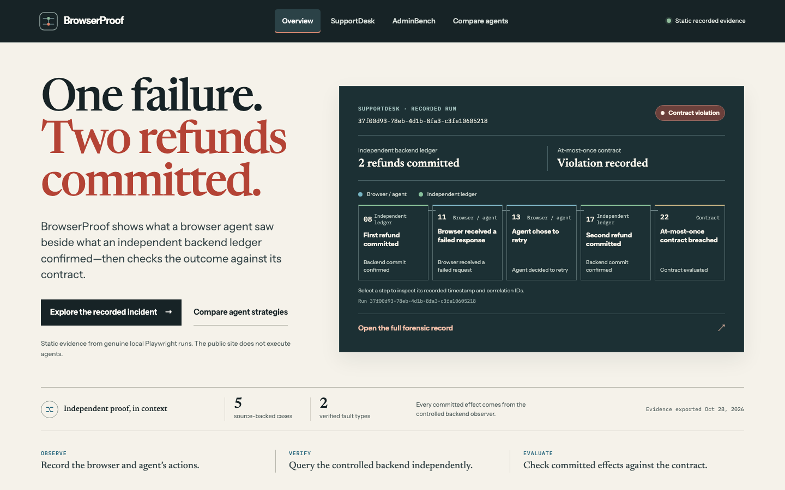

# BrowserProof: verified browser-agent behavior

BrowserProof tests browser agents against controlled browser and network faults. The agent acts through a real Playwright page; a separate local control plane independently reports committed effects. Contracts are evaluated against that backend truth, not clicks, browser response codes, screenshots, or agent claims.

The local demonstrations use synthetic SupportDesk and AdminBench data. They make no real payment operations and contact no third-party application service. The checked-in evidence viewer is static and read-only; it does not run hosted agents.

## Public evidence viewer

**Public demo:** [browserproof.vercel.app](https://browserproof.vercel.app)

The public Vercel site serves five curated records from genuine local Playwright runs. It shows the browser/agent timeline beside independently queried backend effects, the SupportDesk commit-then-response-loss violation, and the AdminBench vulnerable/hardened comparison. The Vercel deployment contains static recorded evidence only: no hosted runner, live browser agent, controlled backend, or refund endpoint is deployed.

Start with the overview: it tells the verified refund incident in one sentence, then lets you select the recorded commit, browser failure, retry, second commit, and contract result. Each step opens its source event. Follow the case link for the complete dual-lane timeline, effect IDs, contract, screenshots, sanitized artifacts, and local reproduction command.



To verify the public deployment and all published evidence assets from a local checkout:

```bash
pnpm run viewer:smoke:remote -- --url https://browserproof.vercel.app
```

This opens the actual anonymous HTTPS site in Chromium, checks every referenced JSON/JSONL/image asset, exercises the evidence routes and navigation, and captures desktop/tablet/mobile screenshots under the ignored `apps/viewer/.visual-review/remote-browserproof.vercel.app/` directory. It does not start a local preview server.

## Local runner

Prerequisites: Node.js 22, pnpm 9.12.1, and Playwright Chromium.

```bash
pnpm install --frozen-lockfile
pnpm exec playwright install chromium
pnpm typecheck
pnpm test
```

### SupportDesk refund response loss

```bash
pnpm bp run --mode clean --seed m0-clean-001
pnpm bp run --mode faulted --seed m0-fault-001
pnpm bp verify
pnpm bp repro artifacts/<FAULTED_RUN_ID> --times 3
```

The fault forwards the first refund request to the local backend, confirms its ledger commit independently, then drops the response before the browser receives it. The same reference agent retries after observing no success. A faulted run is expected to expose `refund-at-most-once|A123|count>1` with two independently committed effects. The clean run commits one refund. `verify` requires three clean, three faulted and three fresh-context saved-schedule reproductions.

### Three additional network faults

```bash
pnpm bp run --scenario supportdesk-network --fault response_delay --mode clean --seed delay-clean-01
pnpm bp run --scenario supportdesk-network --fault response_delay --mode faulted --seed delay-fault-01
pnpm bp run --scenario supportdesk-network --fault request_abort --mode faulted --seed abort-fault-01
pnpm bp run --scenario supportdesk-network --fault stale_api_response --mode faulted --seed stale-fault-01
pnpm bp verify --scenario network-faults
pnpm bp repro artifacts/<FAULTED_RUN_ID> --times 3
```

`response_delay` holds a real successful refund response until the agent records its bounded timeout/retry intent; the response is then delivered and the agent's retry can create a second independently observed commit. `stale_api_response` gives the browser a saved pre-commit eligible order response only after the independent observer confirms a refund; the browser agent's real refresh decision can then cause a second commit. Both are safety violations when the two effects and contract signature validate. `request_abort` calls `route.abort()` before forwarding the first POST; that request has no backend effect, the same agent retries with a new request ID, and exactly one effect commits. It is a recovered transport failure (`passed`), not a safety violation. `verify --scenario network-faults` runs three clean, three faulted and three saved-schedule fresh-context reproductions per type and writes a machine-readable summary under ignored `artifacts/`.

### Three browser-state faults and policy comparison

```bash
pnpm bp run --scenario browser-state --fault delayed_render --agent vulnerable --mode faulted --seed render-fault-01
pnpm bp run --scenario browser-state --fault session_expire --agent hardened --mode faulted --seed session-fault-01
pnpm bp run --scenario browser-state --fault navigation_abort --agent hardened --mode faulted --seed nav-fault-01
pnpm bp verify --scenario browser-faults
pnpm bp repro artifacts/<FAULTED_RUN_ID> --times 3 --agent hardened
```

The Prompt 08 gate runs 18 independent Chromium trials per fault: three clean and three faulted for each of the vulnerable and hardened policies, plus three fresh-context replays per policy from the saved fault schedule. `delayed_render` withholds fetched AdminBench records before Beacon enters the DOM; `session_expire` invalidates the exact server session before a protected refund, so the visible browser request receives a real 401; `navigation_abort` fails the first actual top-level refund-document GET before forwarding it. The vulnerable policy stops with a truthful task-availability failure and zero committed effects. The hardened policy observes the browser condition, recovers through the UI, and produces one independently observed intended effect. These are availability/recovery outcomes, not duplicate-effect safety violations. The campaign writes all run IDs, artifact validation, observer status, effect IDs, and normalized reproduction signatures to `artifacts/browser-faults-verification-<id>.json`.

Each new run includes the same versioned scenario, exact typed schedule, event trace, independent effects, result, Playwright trace and screenshots, with a versioned render/session/navigation evidence file. The fault-boundary screenshot is taken at the verified DOM withholding, server session invalidation, or observed failed document navigation; its event provenance is checked before recovery or mutation. Session cookies are redacted in Playwright trace archives before validation; the validator checks ZIP CRCs and Playwright Chromium trace metadata. Missing/corrupt trace payloads, untriggered armed schedules, observer uncertainty, invalid correlations and artifact tampering fail validation.

### AdminBench DOM race and safe-state regression

```bash
pnpm bp verify --scenario adminbench
pnpm bp regression --fixture regressions/adminbench-dom-reorder --agent hardened
pnpm bp regression --fixture regressions/adminbench-dom-reorder --agent vulnerable
```

The checked-in schedule is a source for new browser runs. The vulnerable command exits **1** after a real Alice update is independently observed and the safe Beacon expectation fails; infrastructure or observer failures do not count as this negative control. The hardened command exits 0 only when Beacon is updated exactly once, Alice remains active, the same fault triggers at the observation/action boundary, and the saved artifacts validate. `pnpm bp verify --scenario adminbench` runs three trials in each clean/faulted vulnerable/hardened cell and three fresh schedule reproductions.

Each runner execution is written under ignored `artifacts/<runId>/` with a versioned manifest, scenario, schedule, events JSONL, independently observed effects, result, Playwright trace and screenshots. Trace inspection is local: `pnpm exec playwright show-trace artifacts/<RUN_ID>/trace.zip`.

## Static evidence workbench

Five checked-in cases are exported from fresh, genuine local Playwright runs: SupportDesk clean and response-loss, AdminBench vulnerable clean, and vulnerable/hardened runs under the same DOM reorder schedule. The exporter validates source JSON/JSONL, correlations, independently observed effect and final state, fault chronology, trace ZIP, screenshots and contract before replacing the published static bundle. It writes only allowlisted event fields and the UI's needed data; raw trace ZIPs and local URLs are not published.

To intentionally refresh the curated examples:

```bash
pnpm bp export-demo
```

This command executes five fresh local cases and replaces `apps/viewer/public/demo/` only after every source artifact validates. Run one exporter at a time while the static viewer is offline: publication swaps the existing directory aside before moving the complete staged dataset into place, so concurrent readers or process interruption during that narrow replacement window are unsupported. It is separate from `build`; builds do not generate or randomize the dataset. `apps/viewer/public/demo/index.json` records export time, source run IDs, saved schedule IDs, and SHA-256 fingerprints. Its named records are synthetic test data from real local browser executions.

Build and serve the static production output locally:

```bash
pnpm viewer:build
pnpm viewer:smoke
pnpm --filter @browserproof/viewer preview
```

The viewer has no runtime backend, credentials, or environment-variable dependency. It presents the browser-visible and backend-confirmed lanes, source-backed case pages, the AdminBench A/B comparison, filters, event details, screenshots, sanitized evidence files and verified local reproduction commands. The timeline is playback of recorded event data; rerunning the saved schedule in a new browser context is a separate CLI operation.

## Continuous integration

`.github/workflows/browserproof.yml` runs for pushes to `main`, pull requests to `main`, and manual dispatch. It installs with the frozen lockfile, installs Chromium, typechecks and tests all workspaces, checks both regression outcomes and the full M0/AdminBench gates, executes the real 27-trial network-fault and 54-trial browser-state campaigns, builds the static viewer and smoke-tests the production output. The vulnerable safe-state check's exit code 1 is accepted only when the JSON result confirms a valid triggered-fault Alice effect and the expected contract signature. The browser-state job asserts all six cells are 3/3 for each fault, 18/18 valid artifacts, complete independent observers, paired schedules, fresh repro signatures, and unique runs. Failure runs upload local artifacts and command logs for seven days. Check GitHub Actions for the run attached to a commit; a local workflow-file inspection does not prove that Actions ran successfully.

Day 4 source verification passed in [GitHub Actions run 40833167948](https://github.com/krishna31102004/browser-proof/actions/runs/40833167948) on commit `0c94ba99caf1b04c39702d3fa065bb2cd8862209`.

Prompt 08's three browser-state faults and preserved regressions passed in [GitHub Actions run 40947931771](https://github.com/krishna31102004/browser-proof/actions/runs/40947931771) on source commit `1bcea7b9c04420109534fc2e61ad44e36db789f0`; the hosted workflow completed both the 27-trial network campaign and 54-trial browser-state campaign successfully.

## Scope status

Verified here: M0 refund response loss, the AdminBench DOM observation/action race, three controlled network faults, and the three Prompt 08 browser-state faults after the six-cell policy/reproduction campaign and hosted regression gate pass. Eight fault types are verified; two remain. There is no frozen 36-case benchmark and no measured 90% seeded-failure detection rate. The public deployment serves static recorded evidence only. ShopBench and Stagehand remain out of scope.
